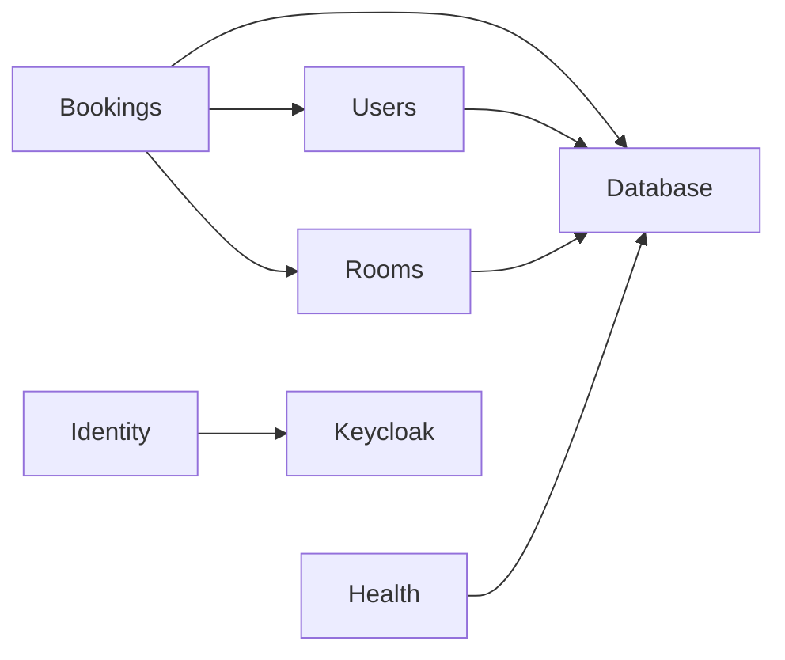

# Kiến trúc

Quy tắc layer, dependency và style nằm tại [coding standards](coding-standards.md). Tài liệu này mô tả các module và luồng xử lý đang triển khai.

Ứng dụng sử dụng NestJS modular monolith: một tiến trình API, các feature có ranh giới riêng và giao tiếp qua DI. PostgreSQL lưu dữ liệu ứng dụng; Keycloak quản lý danh tính. Client/Admin là hai giao diện HTTP của cùng hệ thống nghiệp vụ.

## 1. Ranh giới module

Module được phân chia theo quyền sở hữu hành vi và dữ liệu. Module khác sử dụng hành vi công khai, không thao tác trực tiếp entity hoặc repository của feature sở hữu dữ liệu.

| Module | Phạm vi sở hữu | API cho module khác |
|---|---|---|
| Identity | Xác minh token, tạo principal và kiểm tra role; không lưu hồ sơ hoặc truy cập repository Users | Kiểu `Principal`, decorators; JWT/Roles guards được đăng ký toàn cục |
| Users | Hồ sơ ứng dụng trong `users`, ánh xạ Keycloak `sub` sang UUID nội bộ và đồng bộ profile | `UsersQueryApi.requireBySub(sub)` qua token `USERS_QUERY_API` |
| Rooms | Dữ liệu `rooms`, use case create/update/deactivate và truy cập phòng có khóa | `RoomsBookingAccess` qua `RoomsTransactionFactory` |
| Bookings | Dữ liệu `bookings`, use case tạo booking, kiểm tra phòng/thời gian và điều phối transaction | Chưa export API cho module khác |
| Database | Khởi tạo DataSource/pool, cấu hình persistence, lifecycle và migration | Provider `DataSource` |
| Health | Liveness và database readiness | Controller health/readiness |

`BookingsModule` phụ thuộc Users, Rooms và Database. Users/Rooms không phụ thuộc Bookings. Database không import feature service hoặc chứa unit of work nghiệp vụ.



Các mũi tên nội bộ thể hiện Nest module import; Identity truy cập Keycloak qua JWKS. Controller dùng `Principal` và decorator công khai của Identity để tạo input thuần cho application. Import các kiểu/decorator này không tạo thêm Nest module dependency.

## 2. Phân lớp trong feature

Users thể hiện cách tổ chức một feature:

```text
users/
├── users.module.ts
├── application/
│   ├── users.service.ts
│   ├── inputs/sync-user.input.ts
│   ├── errors/user.errors.ts
│   └── ports/user-repository.port.ts
├── presentation/
│   ├── client/                 # Client controller và response DTO
│   └── admin/                  # Admin controller và response DTO
├── public/
│   ├── user.ts                 # Model thuần
│   └── users-query.api.ts      # Interface đọc và DI token công khai
└── infrastructure/
    ├── user.entity.ts
    └── typeorm-user.repository.ts
```

| Thành phần | Trách nhiệm | Dependency |
|---|---|---|
| Presentation | Routing, lấy principal, nhận/validate DTO và map response DTO | Application service, contract Identity |
| Application service | Thực thi use case, kiểm tra điều kiện nghiệp vụ và phối hợp feature | Port hoặc public interface của feature khác |
| Port | Mô tả thao tác mà service cần, bằng input/output nghiệp vụ | Kiểu dữ liệu của feature hoặc contract công khai |
| Infrastructure adapter | Triển khai port bằng TypeORM; truy vấn, mapping entity và xử lý lỗi persistence | Port, entity nội bộ, DataSource/EntityManager |
| Nest module | Đăng ký provider, nối port với adapter và export API cần dùng | Các module cung cấp dependency |

Service là điểm vào use case; entity là mapping persistence. Application nhận input thuần, không nhận HTTP DTO hoặc `Principal`. Service Users/Rooms/Bookings không import `DataSource` hoặc `EntityManager`; các kiểu này chỉ xuất hiện ở tầng persistence. ORM entity không dùng làm response model hoặc truyền xuyên module. Health truy vấn DataSource trực tiếp vì readiness là kiểm tra hạ tầng.

### Client và Admin

`ClientUsersController` và `AdminUsersController` có routing, role policy và response DTO riêng, và cùng đọc qua `UsersService.requireBySub`. Chỉ Client cung cấp `POST /users/sync` để khởi tạo/đồng bộ hồ sơ; Admin được cấp hồ sơ qua CLI. Việc thay đổi contract HTTP của một nhóm không yêu cầu tạo bản sao service hoặc repository.

`AdminRoomsController` cung cấp POST/PATCH quản lý phòng với role Admin. Controller validate/map DTO sang input thuần; Rooms service quyết định trạng thái phòng mới, invariant và lỗi thiếu phòng. Model phản hồi chỉ chứa field công bố trong API contract. Các API Client đọc phòng và HTTP deactivate chưa được triển khai.

Role được kiểm tra ở guard trước khi gọi controller. Quy tắc dữ liệu thuộc use case: ví dụ lấy UUID user qua Users service và kiểm tra trạng thái phòng trong transaction booking. Controller không tự truy vấn database hoặc mở transaction. Quyền HTTP không được suy ra từ tên OAuth client; Employee/Admin được xác định từ role trong principal.

## 3. Contract, DI và giao tiếp giữa module

Port thuộc module sở hữu hành vi: `UserReadRepositoryPort` và `UserSyncRepositoryPort` thuộc Users, `RoomsBookingAccess` thuộc Rooms, `BookingUnitOfWork` thuộc Bookings. Các repository port nội bộ không phải API cho module khác.

Module nối interface với adapter bằng DI token. Hai port đọc/ghi nội bộ của Users dùng chung `TypeormUserRepository` qua `useExisting`. API cho module khác chỉ cung cấp thao tác đọc:

```ts
// users.module.ts
providers: [
  UsersService,
  // Các binding repository nội bộ được lược bỏ.
  { provide: USERS_QUERY_API, useExisting: UsersService },
],
exports: [USERS_QUERY_API],

// BookingsService
constructor(
  @Inject(USERS_QUERY_API) private readonly users: UsersQueryApi,
  @Inject(BOOKING_UNIT_OF_WORK) private readonly uow: BookingUnitOfWork,
) {}
```

Ở runtime, Nest inject implementation đã đăng ký. Bookings import `UsersModule` và inject token `USERS_QUERY_API`; không phụ thuộc concrete service, repository hoặc quyền sync. Không có lớp facade chuyển tiếp: Users service trực tiếp triển khai interface đọc.

Có hai hình thức giao tiếp:

| Trường hợp | Contract | Ví dụ |
|---|---|---|
| Gọi một thao tác độc lập | Public interface và token, không có kiểu ORM | Bookings gọi `UsersQueryApi.requireBySub` trước transaction |
| Phối hợp persistence trong một transaction | Port nghiệp vụ và factory tích hợp công khai ở infrastructure | Adapter unit of work gọi `RoomsTransactionFactory.bind(manager)` |

`RoomsTransactionFactory` nhận `EntityManager` và trả `RoomsBookingAccess`. Bookings chỉ nhận thao tác `lockForBooking`; `RoomEntity` vẫn nằm trong Rooms. Chỉ infrastructure của Bookings được sử dụng factory có kiểu TypeORM, còn application service nhận các port qua callback unit of work.

Điểm tích hợp này gắn persistence của hai module với TypeORM và cùng PostgreSQL. Khi thay ORM, phải thay factory và adapter unit of work tương ứng; contract service và `RoomsBookingAccess` không chứa kiểu ORM. `DatabaseModule` chỉ cung cấp kết nối, không trở thành nơi tập trung nghiệp vụ của các feature.

## 4. Transaction và tính nhất quán

`BookingsService` sở hữu thứ tự xử lý của use case; `TypeormBookingUnitOfWork` sở hữu cơ chế mở/đóng transaction. Contract callback gồm `{ rooms, bookings }`, không trả manager cho service.

```text
BookingsService.create
  → UsersQueryApi.requireBySub(input.actorSub) → users.id
  → BookingUnitOfWork.run(callback)
      → mở transaction READ COMMITTED
      → tạo Rooms access và booking repository với cùng manager
      → khóa dòng phòng, kiểm tra active
      → kiểm tra startAt/endAt sau khi chờ khóa
      → insert booking với status confirmed do application chọn
      → commit / rollback
```

Lookup user trước transaction chỉ đọc UUID đã tồn tại; thiếu hồ sơ ném `UserNotProvisionedError` (409) trước khi mở transaction booking. User được khởi tạo qua sync hoặc CLI. UUID ổn định và FK `ON DELETE RESTRICT` duy trì liên kết booking; transaction booking không cập nhật profile. Input booking chứa `Date`, không chứa request DTO; adapter HTTP/CLI chịu trách nhiệm parse dữ liệu đầu vào.

`RoomsService.deactivate` cũng điều phối UoW: lấy phòng có khóa, ném `RoomNotFoundError` nếu không tồn tại, rồi yêu cầu `setActive(id, false)`. Repository chỉ đọc/ghi trạng thái bằng manager được bind. Phòng đã inactive vẫn được xử lý thành công; deactivate không hủy booking đã có.

Create phòng dùng `RoomCreationRepositoryPort` cho một insert nguyên tử; application đặt `isActive = true`. Update dùng Rooms UoW, khóa row bằng cùng protocol của deactivate/booking, rồi chỉ cập nhật field có trong patch. Field không gửi giữ nguyên; `description: null` xóa mô tả; sửa phòng inactive không kích hoạt lại phòng. UNIQUE `rooms_name_key` bảo vệ tên dưới tranh chấp; adapter chỉ map đúng constraint này sang `RoomNameConflictError` (409), không dùng SELECT kiểm tra trước làm bảo đảm duy nhất.

Sync user là một thao tác persistence nguyên tử qua `upsertIfNewer`. Adapter tự mở transaction để upsert và SELECT fallback khi token cũ/cùng phiên bản; không thêm UoW ngoài tại service. Quy tắc watermark là contract application, điều kiện so sánh được thực thi trong SQL để không mất tính nguyên tử khi có request đồng thời.

Room access và booking repository được tạo cho từng callback. Chúng kiểm tra transaction active/released trước mỗi thao tác và không được cache hoặc sử dụng sau callback. DataSource, factory và adapter unit of work là singleton; transaction manager không được lưu trong thuộc tính singleton.

### Khóa phòng và chống trùng lịch

Tạo booking khóa dòng phòng bằng `SELECT ... FOR UPDATE` trước khi kiểm tra active. Deactivate cũng khóa dòng đó trong transaction của Rooms. Chỉ kiểm tra active trước transaction sẽ cho phép deactivate chen giữa bước đọc và insert.

| Thứ tự giữ khóa | Kết quả |
|---|---|
| Deactivate trước | Booking chờ, đọc trạng thái inactive sau commit và ném `RoomUnavailableError` |
| Booking trước | Deactivate chờ booking commit; booking được giữ lại khi phòng chuyển inactive |

Khóa dòng tuần tự hóa mọi booking cùng phòng, kể cả các khoảng giờ không giao nhau. Đây là chi phí của cách kiểm soát trạng thái phòng hiện tại; transaction cần ngắn, không gọi mạng hoặc mở transaction độc lập bên trong callback.

Exclusion constraint `bookings_no_overlap` bảo vệ quy tắc khoảng thời gian `[startAt, endAt)` tại database, kể cả khi có thao tác ghi ngoài luồng khóa phòng. Khóa dòng phòng bảo vệ trạng thái phòng; constraint bảo vệ lịch. Chi tiết biểu thức và index nằm trong [database.md](database.md).

Unit of work chuyển riêng lỗi PostgreSQL `23P01` của constraint này thành `BookingTimeConflictError` bên ngoài lời gọi transaction. Lỗi khác được ném tiếp. Exception filter ánh xạ `ApplicationError.kind` sang HTTP status và giữ mã lỗi của feature; service không phụ thuộc HTTP exception. Mất kết nối lúc commit có thể chưa xác định được kết quả; không mặc định mọi lỗi là rollback thành công.

## 5. Identity và HTTP boundary

```text
HTTP request
  → request logging / CORS / payload parser
  → JwtAuthGuard / JwtStrategy: xác minh token, tạo Principal
  → RolesGuard: kiểm tra role của route
  → EmptyBodyInterceptor của sync / validation pipe / controller
  → application service / persistence
  → response interceptor
```

`Principal` chứa Keycloak `sub`, profile snapshot, `issuedAt` tùy chọn và roles đã chuẩn hóa; chỉ presentation sử dụng principal để tạo input. `users.id` là UUID ứng dụng. Identity xác minh danh tính bằng RS256/JWKS, issuer, audience và loại token. Users chỉ tạo/cập nhật hồ sơ qua `sync`; guard không phát sinh truy vấn database. Identity và Users dùng chung validator NumericDate; đọc hồ sơ không yêu cầu `iat`. [Luồng provisioning](user-provisioning.md) mô tả watermark, Client sync, retry và bootstrap Admin.

Keycloak sở hữu đăng ký, đăng nhập, password và refresh token. Hai OAuth client Client/Admin dùng Authorization Code + PKCE và cùng API audience. API xác minh access token offline đến khi hết hạn; role lấy từ `resource_access[API_CLIENT_ID].roles`. Admin được phép dùng Client API; quyền Admin API yêu cầu role Admin.

`JwtAuthGuard` và `RolesGuard` đăng ký toàn cục, authentication chạy trước authorization. `@Public()` bỏ qua cả hai; health và Swagger public. Thiếu/sai token trả 401, thiếu role trả 403; không lấy được JWKS và không có key cache khả dụng trả 503.

Bootstrap tắt parser mặc định của Nest bằng `bodyParser: false`; `configureApp` sở hữu pipeline parser. CORS được gắn trực tiếp qua HTTP adapter trước parser để response lỗi parse vẫn có CORS header cho origin được phép.

Controller sync dùng `EmptyBodyInterceptor`, không kiểm tra header/body trực tiếp. Parser thu nhận kích thước payload; middleware của route đọc payload không thuộc media type được parser hỗ trợ. Các nhánh dùng cùng giới hạn 100 KiB. Interceptor chấp nhận payload rỗng hoặc JSON `{}`; header chunked không được dùng để kết luận body có dữ liệu. Lỗi cú pháp, giới hạn hoặc encoding được parser xử lý trước interceptor, giữ status client error và message an toàn.

`common/application/` chứa error contract thuần; `common/validation/` chứa validator dùng chung; `common/http/` cung cấp response interceptor, exception filter và request logging. Request ID theo suốt response/log; log không chứa token, body hoặc SQL. Response metadata đặt tại controller, cấu hình Swagger ở `src/http/swagger.ts`. Các quy ước wire format nằm trong [API contract](requirements.md).

## 6. Persistence và vận hành

Một DataSource/pool dùng chung cho tiến trình API, đóng qua shutdown hook. TypeORM CLI chạy migration trong tiến trình riêng. Ứng dụng và Keycloak dùng chung PostgreSQL/database nhưng tách schema, database role và quyền object; mỗi bên quản lý migration trong schema của mình.

Cấu hình local, lệnh chạy và kiểm thử nằm tại [README](../README.md). Schema, ACL và migration policy nằm tại [database.md](database.md); ví dụ adapter và DI đầy đủ tại [implementation-patterns.md](implementation-patterns.md).
