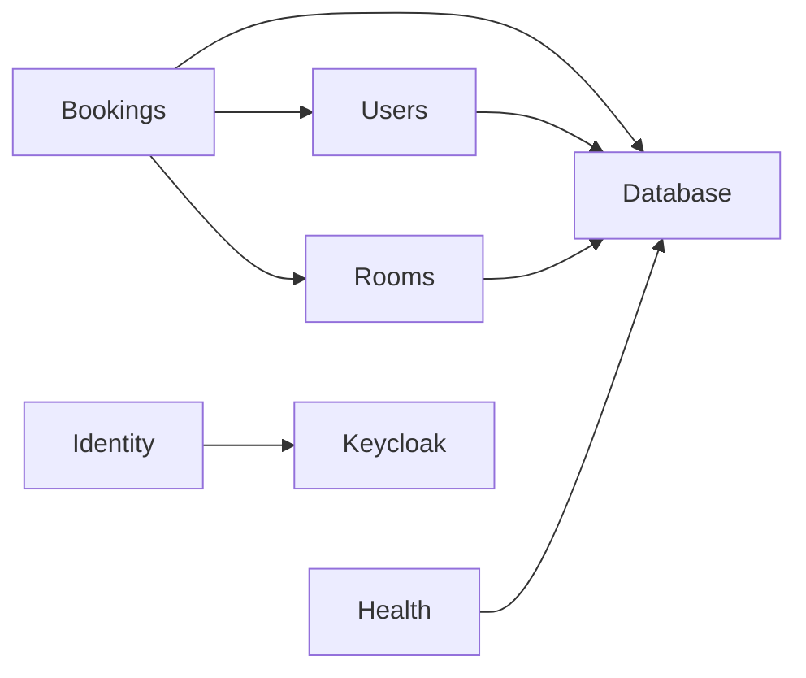

# Kiến trúc

Ứng dụng sử dụng NestJS modular monolith: một tiến trình API, các feature có ranh giới riêng và giao tiếp qua DI. PostgreSQL lưu dữ liệu ứng dụng; Keycloak quản lý danh tính. Client/Admin là hai giao diện HTTP của cùng hệ thống nghiệp vụ.

## 1. Ranh giới module

Module được phân chia theo quyền sở hữu hành vi và dữ liệu. Module khác sử dụng hành vi công khai, không thao tác trực tiếp entity hoặc repository của feature sở hữu dữ liệu.

| Module | Phạm vi sở hữu | API cho module khác |
|---|---|---|
| Identity | Xác minh token, tạo principal và kiểm tra role; không lưu hồ sơ hoặc truy cập repository Users | Kiểu `Principal`, decorators; JWT/Roles guards được đăng ký toàn cục |
| Users | Hồ sơ ứng dụng trong `users`, ánh xạ Keycloak `sub` sang UUID nội bộ và đồng bộ profile | `UsersService.getOrSync(principal)` |
| Rooms | Dữ liệu `rooms`, thao tác deactivate và truy cập phòng có khóa | `RoomsService.deactivate(id)`; `RoomsBookingAccess` qua `RoomsTransactionFactory` |
| Bookings | Dữ liệu `bookings`, use case tạo booking, kiểm tra phòng/thời gian và điều phối transaction | `BookingsService.create(principal, dto)` |
| Database | Khởi tạo DataSource/pool, cấu hình persistence, lifecycle và migration | Provider `DataSource` |
| Health | Liveness và database readiness | Controller health/readiness |

`BookingsModule` phụ thuộc Users, Rooms và Database. Users/Rooms không phụ thuộc Bookings. Database không import feature service hoặc chứa unit of work nghiệp vụ.



Các mũi tên nội bộ thể hiện Nest module import; Identity truy cập Keycloak qua JWKS. Feature cũng có thể import kiểu TypeScript công khai, ví dụ Users nhận `Principal` từ Identity; việc đó không tạo thêm provider hoặc Nest module dependency.

## 2. Phân lớp trong feature

Users thể hiện cách tổ chức một feature:

```text
users/
├── users.module.ts
├── users.service.ts
├── presentation/
│   ├── client/                 # Client controller và response DTO
│   └── admin/                  # Admin controller và response DTO
├── public/
│   └── user.ts                 # Kiểu dữ liệu công khai
├── ports/
│   └── user-repository.port.ts # Contract persistence và DI token
└── infrastructure/
    ├── user.entity.ts
    └── typeorm-user.repository.ts
```

| Thành phần | Trách nhiệm | Dependency |
|---|---|---|
| Presentation | Routing, lấy principal, nhận/validate DTO và map response DTO | Application service, contract Identity |
| Application service | Thực thi use case, kiểm tra điều kiện nghiệp vụ và phối hợp feature | Port hoặc service công khai của feature khác |
| Port | Mô tả thao tác mà service cần, bằng input/output nghiệp vụ | Kiểu dữ liệu của feature hoặc contract công khai |
| Infrastructure adapter | Triển khai port bằng TypeORM; truy vấn, mapping entity và xử lý lỗi persistence | Port, entity nội bộ, DataSource/EntityManager |
| Nest module | Đăng ký provider, nối port với adapter và export API cần dùng | Các module cung cấp dependency |

Nghiệp vụ hiện nằm trong application service; entity là mapping persistence. Không coi ORM entity là response model hoặc dùng entity xuyên module. Service Users/Rooms/Bookings không import `DataSource` hoặc `EntityManager`; các kiểu này chỉ xuất hiện ở tầng persistence. Health truy vấn DataSource trực tiếp vì readiness là kiểm tra hạ tầng.

### Client và Admin

`ClientUsersController` và `AdminUsersController` có routing, role policy và response DTO riêng, nhưng đều gọi `UsersService.getOrSync`. Việc thay đổi contract HTTP của một nhóm không yêu cầu tạo bản sao service hoặc repository.

Role được kiểm tra ở guard trước khi gọi controller. Quy tắc dữ liệu thuộc use case: ví dụ lấy UUID user qua Users service và kiểm tra trạng thái phòng trong transaction booking. Controller không tự truy vấn database hoặc mở transaction. Quyền HTTP không được suy ra từ tên OAuth client; Employee/Admin được xác định từ role trong principal.

## 3. Contract, DI và giao tiếp giữa module

Port thuộc module sở hữu hành vi: `UserRepositoryPort` thuộc Users, `RoomsBookingAccess` thuộc Rooms, `BookingUnitOfWork` thuộc Bookings. Các repository port nội bộ không phải API cho module khác.

Module nối interface với adapter bằng DI token. Ví dụ Users:

```ts
// users.module.ts
providers: [
  UsersService,
  { provide: USER_REPOSITORY, useClass: TypeormUserRepository },
],
exports: [UsersService],

// users.service.ts
constructor(
  @Inject(USER_REPOSITORY) private readonly repository: UserRepositoryPort,
) {}
```

Ở runtime, Nest inject adapter đã đăng ký. Service phụ thuộc contract; test có thể thay provider qua token. Module khác import `UsersModule` và inject `UsersService`, không inject `TypeormUserRepository` hoặc token repository nội bộ.

Có hai hình thức giao tiếp:

| Trường hợp | Contract | Ví dụ |
|---|---|---|
| Gọi một use case độc lập | Service công khai, không có kiểu ORM | Bookings gọi `UsersService.getOrSync` trước transaction |
| Phối hợp persistence trong một transaction | Port nghiệp vụ và factory tích hợp công khai ở infrastructure | Adapter unit of work gọi `RoomsTransactionFactory.bind(manager)` |

`RoomsTransactionFactory` nhận `EntityManager` và trả `RoomsBookingAccess`. Bookings chỉ nhận thao tác `lockForBooking`; `RoomEntity` vẫn nằm trong Rooms. Chỉ infrastructure của Bookings được sử dụng factory có kiểu TypeORM, còn application service nhận các port qua callback unit of work.

Điểm tích hợp này gắn persistence của hai module với TypeORM và cùng PostgreSQL. Khi thay ORM, phải thay factory và adapter unit of work tương ứng; contract service và `RoomsBookingAccess` không chứa kiểu ORM. `DatabaseModule` chỉ cung cấp kết nối, không trở thành nơi tập trung nghiệp vụ của các feature.

## 4. Transaction và tính nhất quán

`BookingsService` sở hữu thứ tự xử lý của use case; `TypeormBookingUnitOfWork` sở hữu cơ chế mở/đóng transaction. Contract callback gồm `{ rooms, bookings }`, không trả manager cho service.

```text
BookingsService.create
  → UsersService.getOrSync(principal) → users.id
  → BookingUnitOfWork.run(callback)
      → mở transaction READ COMMITTED
      → tạo Rooms access và booking repository với cùng manager
      → khóa dòng phòng, kiểm tra active
      → kiểm tra startAt/endAt sau khi chờ khóa
      → insert booking
      → commit / rollback
```

User upsert nằm ngoài transaction booking vì profile là snapshot danh tính, không phải một phần của thao tác giữ phòng. Booking thất bại vẫn giữ profile; luồng HTTP tiếp theo tiếp tục sử dụng cùng UUID theo `keycloak_sub`.

Room access và booking repository được tạo cho từng callback. Chúng kiểm tra transaction active/released trước mỗi thao tác và không được cache hoặc sử dụng sau callback. DataSource, factory và adapter unit of work là singleton; transaction manager không được lưu trong thuộc tính singleton.

### Khóa phòng và chống trùng lịch

Tạo booking khóa dòng phòng bằng `SELECT ... FOR UPDATE` trước khi kiểm tra active. Deactivate cũng khóa dòng đó trong transaction của Rooms. Chỉ kiểm tra active trước transaction sẽ cho phép deactivate chen giữa bước đọc và insert.

| Thứ tự giữ khóa | Kết quả |
|---|---|
| Deactivate trước | Booking chờ, đọc trạng thái inactive sau commit và ném `RoomUnavailableError` |
| Booking trước | Deactivate chờ booking commit; booking được giữ lại khi phòng chuyển inactive |

Khóa dòng tuần tự hóa mọi booking cùng phòng, kể cả các khoảng giờ không giao nhau. Đây là chi phí của cách kiểm soát trạng thái phòng hiện tại; transaction cần ngắn, không gọi mạng hoặc mở transaction độc lập bên trong callback.

Exclusion constraint `bookings_no_overlap` bảo vệ quy tắc khoảng thời gian `[startAt, endAt)` tại database, kể cả khi có thao tác ghi ngoài luồng khóa phòng. Khóa dòng phòng bảo vệ trạng thái phòng; constraint bảo vệ lịch. Chi tiết biểu thức và index nằm trong [database.md](database.md).

Unit of work chuyển riêng lỗi PostgreSQL `23P01` của constraint này thành `BookingTimeConflictError` sau khi transaction rollback. Lỗi khác được ném tiếp. Exception filter ánh xạ lỗi nghiệp vụ sang HTTP status và error envelope; service không phụ thuộc HTTP exception.

## 5. Identity và HTTP boundary

```text
Bearer token
  → JwtAuthGuard / JwtStrategy: xác minh token, tạo Principal
  → RolesGuard: kiểm tra role của route
  → validation pipe / controller
  → application service / persistence
  → response interceptor
```

`Principal` chứa Keycloak `sub`, profile snapshot và roles đã chuẩn hóa; `users.id` là UUID ứng dụng. Identity xác minh danh tính bằng RS256/JWKS, issuer, audience và loại token. Users chỉ tạo/cập nhật hồ sơ khi use case gọi `getOrSync`; guard không phát sinh truy vấn database.

Keycloak sở hữu đăng ký, đăng nhập, password và refresh token. Hai OAuth client Client/Admin dùng Authorization Code + PKCE và cùng API audience. API xác minh access token offline đến khi hết hạn; role lấy từ `resource_access[API_CLIENT_ID].roles`. Admin được phép dùng Client API; quyền Admin API yêu cầu role Admin.

`JwtAuthGuard` và `RolesGuard` đăng ký toàn cục, authentication chạy trước authorization. `@Public()` bỏ qua cả hai; health và Swagger public. Thiếu/sai token trả 401, thiếu role trả 403; không lấy được JWKS và không có key cache khả dụng trả 503.

`common/` cung cấp response interceptor, exception filter và request logging. Request ID theo suốt response/log; log không chứa token hoặc body. Các quy ước wire format nằm trong [API contract](requirements.md).

## 6. Persistence và vận hành

Một DataSource/pool dùng chung cho tiến trình API, đóng qua shutdown hook. TypeORM CLI chạy migration trong tiến trình riêng. Ứng dụng và Keycloak dùng chung PostgreSQL/database nhưng tách schema, database role và quyền object; mỗi bên quản lý migration trong schema của mình.

Cấu hình local, lệnh chạy và kiểm thử nằm tại [README](../README.md). Schema, ACL và migration policy nằm tại [database.md](database.md); ví dụ adapter và DI đầy đủ tại [implementation-patterns.md](implementation-patterns.md).
