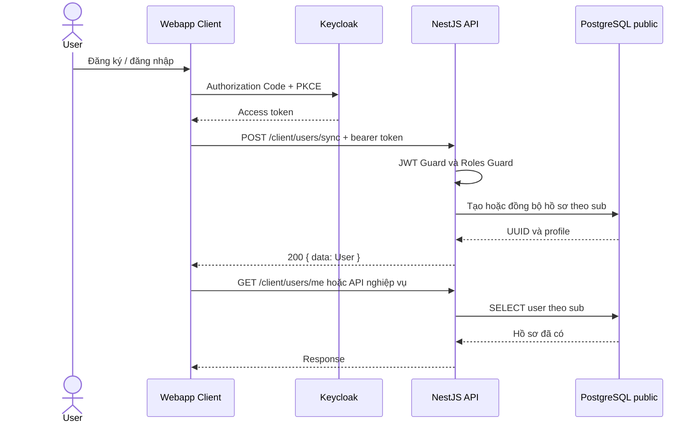
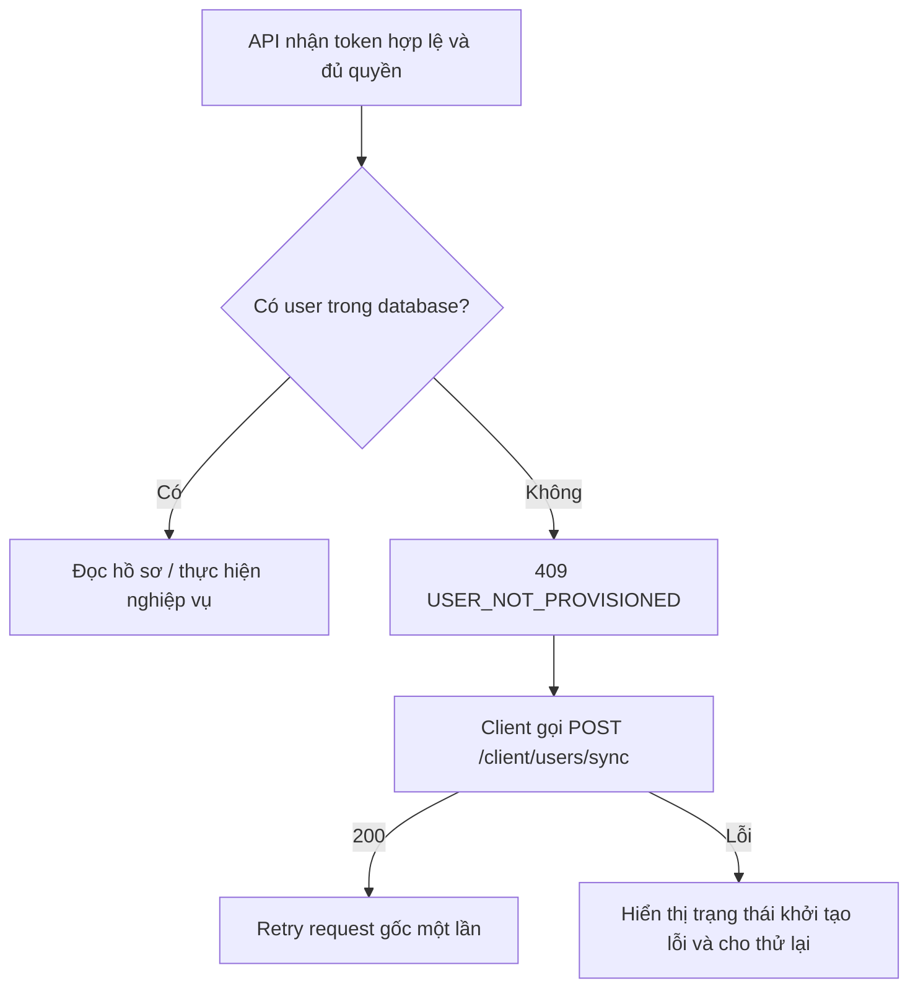

# Khởi tạo hồ sơ user từ webapp

Thiết kế thay thế việc upsert user trong `/users/me` và use case booking. Tài liệu dùng để review trước khi thay đổi code; các contract bên dưới chưa được triển khai.

## 1. Ranh giới trách nhiệm

| Thành phần | Trách nhiệm |
|---|---|
| Keycloak | Đăng ký tài khoản, password, đăng nhập, role và phát token |
| Webapp Client | Gọi đồng bộ hồ sơ sau đăng nhập, chờ thành công rồi sử dụng API nghiệp vụ |
| Identity | Xác minh access token và tạo principal; không ghi database |
| Users | Khởi tạo/đồng bộ hồ sơ qua endpoint riêng; cung cấp truy vấn user theo `sub` |
| Bootstrap/CLI | Cấp tài khoản và hồ sơ ứng dụng cho Admin |

Luồng Client không tạo tài khoản Keycloak qua API ứng dụng, không chuyển password qua API ứng dụng và không phụ thuộc webhook. `sub` từ token đã xác minh là khóa liên kết; UUID `users.id` là định danh nghiệp vụ của ứng dụng. Client không tự chỉ định UUID, `sub` hoặc role.

## 2. Luồng Client



1. User đăng ký hoặc đăng nhập trên Keycloak. Đăng ký thành công ở Keycloak chưa đồng nghĩa có hồ sơ ứng dụng.
2. Sau khi nhận token, webapp gọi `POST /api/v1/client/users/sync` và chờ 200 trước khi mở dữ liệu nghiệp vụ.
3. API lấy danh tính/profile từ principal đã xác minh và thực hiện một transaction PostgreSQL. Không gọi Keycloak Admin API hoặc giữ transaction qua lời gọi mạng.
4. Webapp dùng profile trả về để khởi tạo session UI; `/users/me` và booking chỉ truy vấn user đã tồn tại.

Webapp gọi sync khi thiết lập phiên đăng nhập, khôi phục phiên sau khi reload, hoặc sau khi đổi profile ở Keycloak và lấy token mới. Không gắn sync vào mỗi API request hoặc mỗi lần refresh token nền. Reload/nhiều tab có thể gọi lặp; server phải xử lý an toàn, không phụ thuộc cờ client để chống trùng.

## 3. Contract đồng bộ

```http
POST /api/v1/client/users/sync
Authorization: Bearer <access_token>
```

- Quyền: Employee/Admin theo policy Client API.
- Request không có body; body không rỗng trả 400. Không nhận dữ liệu danh tính, password hoặc role do client tự khai báo.
- Luôn trả 200 với `{ data: { id, email, displayName } }` sau khi transaction commit, cả khi tạo mới hoặc đã có hồ sơ.
- Profile mapping giữ quy tắc Identity: `email` là string hoặc null; `displayName` lấy `name`, sau đó `preferred_username`, cuối cùng null.
- Không phát token và không lưu role/password trong bảng user.

### Gọi lặp, đồng thời và token cũ

Giữ UNIQUE `users.keycloak_sub` và thực hiện thao tác tạo/cập nhật nguyên tử tại database; không dùng mẫu SELECT rồi INSERT không có bảo vệ tranh chấp. Hai request cùng `sub` luôn nhận cùng UUID.

Bổ sung `users.profile_token_iat` nullable để ghi mốc token đã được dùng đồng bộ. Principal cung cấp `issuedAt` từ claim `iat` đã xác minh; endpoint sync yêu cầu `iat` là NumericDate hợp lệ.

| Trạng thái hồ sơ | Xử lý |
|---|---|
| Chưa có | Insert UUID/profile và `profile_token_iat` |
| Đã có, watermark null | Đồng bộ từ token và đặt watermark |
| Token có `iat` lớn hơn watermark | Cập nhật snapshot và watermark, giữ UUID |
| Token có `iat` nhỏ hơn hoặc bằng watermark | Chỉ đọc/trả hồ sơ hiện có, không ghi |

Hai token cùng `iat` sử dụng snapshot được lưu trước; muốn đồng bộ thay đổi tiếp theo phải dùng token được phát ở giây sau. Không dùng `updated_at` làm phiên bản token. Watermark ngăn token cũ ghi đè snapshot mới hơn; đây là snapshot theo token, không phải cơ chế phản ánh tức thời mọi thay đổi trong Keycloak.

Với token mới hơn, transaction cập nhật watermark kể cả khi profile không đổi. Chi phí ghi nằm ở bước thiết lập phiên/đồng bộ rõ ràng; các lần gọi lặp cùng token và các API đọc không cập nhật timestamp hoặc profile.

## 4. Luồng đọc và phục hồi lỗi



`GET /api/v1/client/users/me` và `GET /api/v1/admin/users/me` chỉ SELECT hồ sơ. Use case tạo booking lấy user bằng truy vấn theo `sub`; không còn gọi `getOrSync` hoặc tự khởi tạo hồ sơ. Guard tiếp tục chỉ xác thực/phân quyền.

| Tình huống | Kết quả và phục hồi |
|---|---|
| Thiếu/sai/hết hạn token | 401; client đăng nhập hoặc refresh trước khi thử sync lại |
| Không đủ role | 403; không tạo/cập nhật hồ sơ |
| Token hợp lệ nhưng chưa có hồ sơ khi đọc/thực hiện nghiệp vụ | 409, code `USER_NOT_PROVISIONED`; không ghi database |
| Database lỗi trong sync | Transaction rollback; trả 503 với thông báo tổng quát, cho phép gọi lại |
| Commit thành công nhưng client mất response | Gọi lại cùng token; trả cùng UUID, không ghi lặp |
| Không lấy được signing key và không có cache dùng được | 503 theo contract Identity; không tạo hồ sơ |

Client retry lỗi mạng/503 tối đa ba lần với khoảng chờ 1, 2 và 4 giây. Hết lượt thì giữ màn hình khởi tạo lỗi và cho retry thủ công; không điều hướng vào nghiệp vụ khi chưa sync thành công. Không retry tự động với 400/401/403. Khi phục hồi từ `USER_NOT_PROVISIONED`, chỉ replay request gốc một lần sau sync 200 để tránh vòng lặp.

Lỗi database được ánh xạ 503 tại biên persistence cho thao tác này; lỗi lập trình không dự kiến vẫn trả 500. Response lỗi dùng error envelope hiện có, không lộ SQL hoặc token.

## 5. Admin

Không có API đăng ký Admin hoặc `/admin/users/sync`. Bootstrap/CLI cấp account Keycloak và tạo hồ sơ `public.users` theo `sub` trước khi cho Admin sử dụng hệ thống. Thao tác có thể chạy lại và giữ UUID; không lưu password hoặc role trong hồ sơ ứng dụng.

Admin UI đăng nhập rồi gọi `GET /api/v1/admin/users/me` để đọc hồ sơ. Nếu thiếu hồ sơ, trả `USER_NOT_PROVISIONED`; Admin UI báo lỗi cấu hình, không chạy luồng đăng ký Client. Quản trị viên chạy lại bootstrap để hoàn tất phần còn thiếu. Admin sử dụng Client API với hồ sơ đã được cấp sẵn.

## 6. Thay đổi khi triển khai

- Thêm Client sync controller/use case, truy vấn `findBySub` và kiểm tra `requireBySub` cho các use case cần UUID ứng dụng.
- Tách port đọc khỏi thao tác sync; bỏ ghi user trong hai endpoint `/users/me` và trong tạo booking.
- Bổ sung `profile_token_iat` bằng migration; dữ liệu hiện có giữ UUID và nhận watermark ở lần sync tiếp theo. Không tự đồng bộ toàn bộ user khi khởi động API.
- Bổ sung `issuedAt` vào principal từ token hợp lệ; validation `iat` áp dụng cho sync, không biến mọi request đọc thành thao tác đồng bộ.
- Chuyển script bootstrap: hồ sơ Admin được cấp qua CLI; Employee test được tạo ở Keycloak và gọi endpoint sync theo luồng Client để có hồ sơ ứng dụng.
- Cập nhật Swagger, API contract, kiến trúc và ví dụ DI theo luồng đã được duyệt; giữ nguyên đăng ký/đăng nhập/refresh token tại Keycloak.

## 7. Kiểm chứng

- Đăng ký Keycloak xong nhưng chưa gọi sync: chưa có user ứng dụng; đọc hồ sơ/đặt booking không tự insert.
- Sync hợp lệ tạo đúng profile từ principal; dữ liệu danh tính trong body không được chấp nhận.
- Request lặp, mất response sau commit và sync đồng thời cùng `sub`: cùng UUID, không trùng dòng.
- Token cũ hoặc cùng `iat` không ghi đè profile, không đổi `updated_at`; token mới hơn cập nhật snapshot/watermark đúng thứ tự, kể cả khi request hoàn tất ngược thứ tự.
- Lỗi database rollback và retry thành công; lỗi 401/403 không tạo dữ liệu.
- `/users/me` và lookup user trong booking chỉ đọc; role/owner policy không bị thay đổi bởi việc client gọi sync.
- Bootstrap Admin hoàn tất hồ sơ mà không cần gọi API sync; chạy lại giữ UUID.
- Migration giữ nguyên user/booking hiện có và các FK; user cũ có watermark null được sync lần đầu an toàn.
